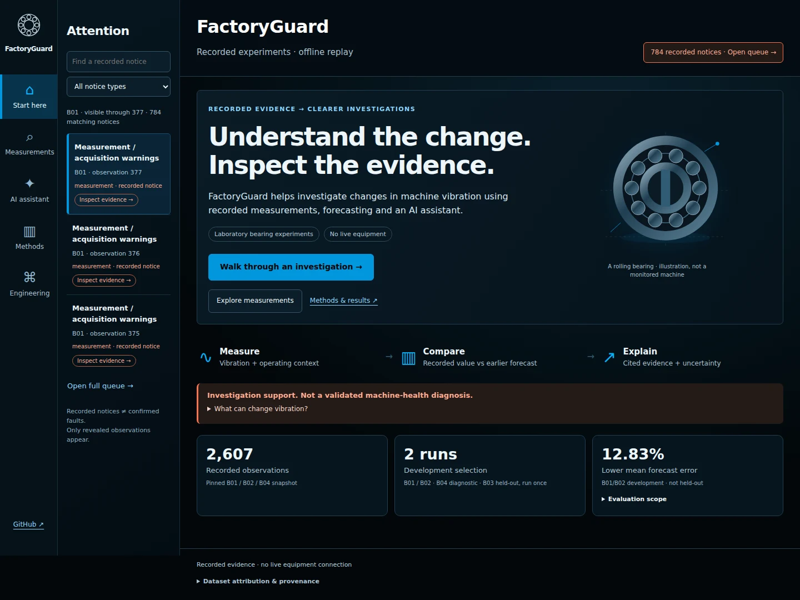
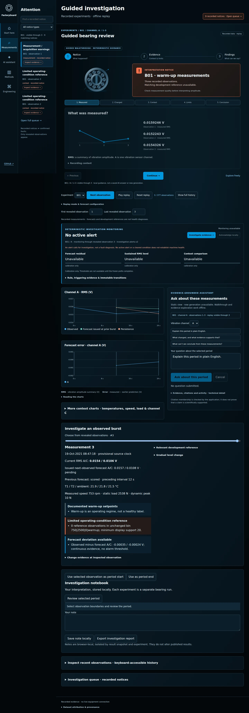

<picture>
  <source media="(max-width: 600px)" srcset="docs/images/readme/hero-mobile.svg">
  
</picture>

  <a href="https://bakk0u.github.io/factoryguard/"><b>Open the dashboard ↗</b></a> &nbsp; · &nbsp;
  <a href="#results--evidence">Results &amp; evidence</a> &nbsp; · &nbsp;
  <a href="docs/development_release.md">Reproduce locally</a> &nbsp; · &nbsp;
  <a href="docs/architecture.md">Architecture</a>

**Investigate changes in bearing vibration and temperature with the operating context beside them.** FactoryGuard brings together observed signals, forecasts, speed, load, acquisition gaps and measurement warnings in an interactive investigation dashboard.

> **Try it immediately:** the [public dashboard](https://bakk0u.github.io/factoryguard/) needs no installation, sign-in or dataset download. It presents **real, precomputed laboratory results**; it does not connect to live equipment or retrain a model when opened.

## Project status · v0.5.0

The research prototype is implemented and merged into `master`: reproducible
forecasting, an investigation dashboard, deterministic alerts, SQLite replay and
an optional evidence-grounded MCP/RAG assistant. The held-out forecasting check
and prediction-interval evaluation are complete.

| Complete | Evidence |
| :--- | :--- |
| **Held-out forecasting** | **14.2% lower MAE** than persistence on B03, evaluated once with the frozen method. |
| **Prediction intervals** | **89.5% / 89.4% coverage** on channels A/C at a 90% target. |
| **Reproduction** | B01/B02/B04 feature hashes and all 32-candidate campaign metrics reproduced from raw data. |
| **Engineering verification** | v0.5.0 records **209 passing local Python tests**; pre-merge Linux/Windows core and Linux assistant checks passed. Windows assistant remains advisory and failing. |

[**v0.5.0 release notes**](docs/releases/v0.5.0.md) ·
[Current status](docs/project_status.md) ·
[CI runs](https://github.com/bakk0u/factoryguard/actions)

**Evaluation scope:** next-burst vibration forecasting and calibrated prediction
intervals, checked on a held-out bearing run. Alerts support evidence-based
investigation. [Evaluation details and boundaries](#evaluation-details).

**Source and public demo differ:** v0.5.0 is merged source with release notes.
The latest published GitHub release is still
[v0.3.0](https://github.com/bakk0u/factoryguard/releases/tag/v0.3.0).
The screenshots below show the current local dashboard; the public demo predates
this redesign. A deployment of the current version has not been verified. The optional
assistant runs locally and is not hosted on the public static site.

## Explore the dashboard

Optional local extension: [evidence-grounded investigation assistant](docs/assistant.md)
retrieves recorded evidence through MCP before generating an answer. The public
static dashboard remains independent; offline fixture mode and opt-in live mode
are labelled separately. No new forecasting-model training is involved.

Prototype assistant support: Linux CI and local macOS verified; Windows assistant
integration is unsupported, with a visible non-blocking compatibility job.
Windows core checks remain blocking. [Platform scope and checks](docs/results/investigation-alerts-v2/platform-closeout.md).

Implemented prototype: [deterministic investigation alerts v2](docs/results/investigation-alerts-v2/report.md)
combine saved forecast errors, RMS level changes and supported operating context.
They work without an LLM and expose their evidence and monitoring limitations;
fault sensitivity and false-alarm rates are not established. Counted level evidence
uses disjoint windows; unresolved episodes remain visible when assessment is unavailable.

<a href="https://bakk0u.github.io/factoryguard/">
  <picture>
    <source media="(max-width: 600px)" srcset="docs/images/readme/dashboard-v050-mobile.webp">
    
  </picture>
</a>

Current local dashboard · Click to open the public demo (earlier version)

## From a change to an investigation

<picture>
  <source media="(max-width: 600px)" srcset="docs/images/readme/workflow-mobile.svg">
  
</picture>

The current local reviewer opens on **Start here → Walk through an investigation**:
a deterministic B01/A example needs no API key. **Explore measurements** retains
replay, notes and evidence exports; **AI assistant** sits beside the selected
measurements. **Methods & results** and **Engineering** provide deeper evidence
and reproducibility. See the [local reviewer guide](docs/reviewer_site.md).
The local Layout 3 presentation adds a revealed-notice rail and a clickable
Engineering system map, with short examples and expandable technical details.
The screenshots show this current interface. The public demo remains an earlier
deployment.

| Investigate | What you can inspect |
| :--- | :--- |
| **Signal & forecast** | Observed RMS, model forecasts, persistence and settled errors, with acquisition gaps retained. |
| **Operating context** | Temperature above ambient, measured speed/load and optional commanded values. |
| **Changes & references** | Descriptive sudden/sustained changes and fixed development-reference support. |
| **Investigation record** | Browser-local notes and downloadable selected-period reports. |

<b>See the investigation view</b>

<picture>
  <source media="(max-width: 600px)" srcset="docs/images/readme/investigation-v050-mobile.webp">
  
</picture>

Experiments are separate bearing runs. A/C are vibration channels on the same run.

## Results & evidence

| Held-out forecast accuracy | Held-out interval coverage | Development selection | Model comparison |
| :---: | :---: | :---: | :---: |
| **14.2%** lower MAE than persistence | **89.5% / 89.4%** at a 90% target | **12.83%** lower MAE | **432** comparison rows |
| Sealed run B03, frozen method, evaluated once | Calibrator frozen before B03 was opened | Reciprocal B01/B02, used for selection | Includes unsuccessful variants |

**Interpretation:** the method, metrics and interval calibrator were frozen and committed before the sealed B03 run was opened; B03 was then evaluated **once** ([result](docs/results/b03-holdout/README.md), [pre-execution review](docs/results/b03-holdout/review.md)). The held-out improvement (14.2%) is in line with the development estimate (12.83%). It is one laboratory bearing, a next-burst forecast, and **not fault-detection performance**: when operating conditions did not change between bursts (31 of 611 pairs), smoothing was no better than persistence.

**Uncertainty:** fixed-width intervals covered only about half of late-run errors. A causal adaptive calibrator selected on B01/B02 reached 89.5% / 89.4% coverage on B03 with less than half the interval score ([method and results](docs/uncertainty_calibration.md)).

**Measurement validity:** B04's logged shaft speed is about half the commanded speed. The rotation frequency visible in the raw vibration spectrum matches the commanded speed in 90% of recordings and the logged one in 6%, so the log column is a scaling artefact, not a different operating regime ([review](docs/results/measurement-validity/README.md)).

**Alerts:** deterministic investigation prompts. The dataset has no dated fault events or verified-normal intervals, so recall, false-alert rate and detection delay cannot be measured and are not claimed ([why, and the acceptance protocol fixed for future labelled data](docs/alert_validation.md)).

Exponential smoothing was selected from a bounded comparison with persistence, Ridge, randomized trees, gradient boosting and XGBoost. The dashboard overview shows the best evaluated variant within each family; it does not claim exhaustive optimization. Every evaluated variant remains available, including worse results.

[**Read the model card ↗**](docs/model_card.md) · [Complete results](docs/results/release-v3/results.md) · [Forecast uncertainty audit](docs/forecast_uncertainty.md) · [Verification record](docs/release_verification.md)

| Bearing runs | Role | Boundary |
| :--- | :--- | :--- |
| **B01 / B02** | Development & selection | Repeatedly inspected and used for selection. |
| **B04** | Diagnostic only | Logged speed shown to be a factor-of-two logging artefact; dynamic-load scaling still open. Retained uncorrected. |
| **B03** | Held-out reserve | Sealed until 2026-11-13, then evaluated once with the frozen method. No longer an untouched holdout. |

> Forecast deviations and development references do **not** establish damage onset, fault probabilities, bearing health or remaining useful life. Development references are not healthy/safe ranges.

<b>Evaluation details & verification</b>

B04's dynamic-load scaling remains unresolved; its measurements are retained
uncorrected for diagnostic use. The dataset has no dated fault events or
verified-normal intervals, so fault-detection recall, false-alert rates and
detection delay are not measured. Evaluation covers one held-out laboratory
bearing; live-equipment production operation has not been validated.

Live LLM answer-quality evaluation is incomplete. Linux assistant integration
is verified in CI and macOS locally; Windows assistant remains unsupported.

Two development bearings support model selection and one held-out bearing checks it. Timestamps and CSV/MAT alignment are provisional; sensor-range warnings and ambiguous termination information remain. Next-observed-burst forecasts have a variable horizon.

The [v0.5.0 verification record](docs/releases/v0.5.0.md) reports **209 passing local Python tests**, including interval-calibration and speed-audit tests. The [closeout PR](https://github.com/bakk0u/factoryguard/pull/12) records passing pre-merge Linux/Windows core and Linux assistant checks; Windows assistant failures remain advisory. These are recorded checks, not a claim that this README update reran the suite. The earlier [verification record](docs/release_verification.md) preserves historical dashboard and handover checks.

## Run it your way

| Path | Best for | Start here |
| :--- | :--- | :--- |
| **Public dashboard** | Exploring the results in your browser | [Open dashboard](https://bakk0u.github.io/factoryguard/) |
| **Downloadable reviewer site** | Opening a portable HTML export locally | [`factoryguard-reviewer-site` CI artifact](https://github.com/bakk0u/factoryguard/actions/workflows/ci.yml) |
| **Local Python application** | Reproduction and SQLite-backed investigation state | [Installation & full reproduction](docs/development_release.md) |

<b>Notes, persistence & download behavior</b>

The static website keeps notes **in your browser**, isolated by result snapshot and experiment. Notes are not uploaded; export a report to share them. When storage is unavailable, notes last only in the current tab. Replay progress is not saved.

The optional local Python application persists notes and replay state in SQLite across resets/restarts. See the [reviewer-site guide](docs/reviewer_site.md).

The CI artifact can be extracted and its `index.html` opened without installing Python or downloading raw data. GitHub artifact downloads may require sign-in; the public Pages site does not.

## Technical reading

| Document | Purpose |
| :--- | :--- |
| [Architecture](docs/architecture.md) | Data, evaluation, persistence and presentation components. |
| [Model card](docs/model_card.md) | Selection results, interpretation and limitations. |
| [Reviewer-site guide](docs/reviewer_site.md) | Investigation workflow, notes and exports. |
| [B03 held-out result](docs/results/b03-holdout/README.md) | The single frozen reserve evaluation, with its pre-execution review. |
| [Interval calibration](docs/uncertainty_calibration.md) | Causal prediction intervals: selection on development runs, independent check on B03. |
| [Measurement validity](docs/results/measurement-validity/README.md) | Units, timing and the B04 speed question, checked against raw spectra. |
| [Alert validation status](docs/alert_validation.md) | What can and cannot be claimed about alerts, and the protocol for labelled data. |
| [B03-readiness checklist](docs/b03_readiness.md) | The gates that were completed before the reserve evaluation. |
| [Current v0.5.0 source release notes](docs/releases/v0.5.0.md) | Held-out forecasting, calibrated intervals, reproduction and remaining limitations. |
| [Historical v0.3.0 release](https://github.com/bakk0u/factoryguard/releases/tag/v0.3.0) | Published prior recorded-investigation milestone. |

<b>Data attribution & licensing</b>

Data: **Osarenren Kennedy Aimiyekagbon, Paderborn University**, [Zenodo 10868257](https://doi.org/10.5281/zenodo.10868257), [CC BY 4.0](https://creativecommons.org/licenses/by/4.0/).

Cite Javanmardi et al. (2024), *Remaining Useful Lifetime Estimation of Bearings Operating under Time-Varying Conditions*, DOI **10.36001/phme.2024.v8i1.4101**.

Waveforms were reduced to documented burst descriptors, context, warnings and reference summaries; no raw waveforms are published. B03 appears only as derived descriptors and forecast pairs in the held-out result. No endorsement is implied. [Attribution details](src/factoryguard/release/demo/ATTRIBUTION.md) describe the smaller bundled B01 demo. The legacy `run_step1.py` demo is synthetic and separate from the website results.

Software: [MIT licence](LICENSE). The dataset keeps its own CC BY 4.0 licence; the MIT licence covers this repository's code and documentation only.

---

<a href="https://bakk0u.github.io/factoryguard/"><b>Explore FactoryGuard ↗</b></a> &nbsp; · &nbsp; Built by <a href="https://github.com/bakk0u">Anas Bakkoury</a>

