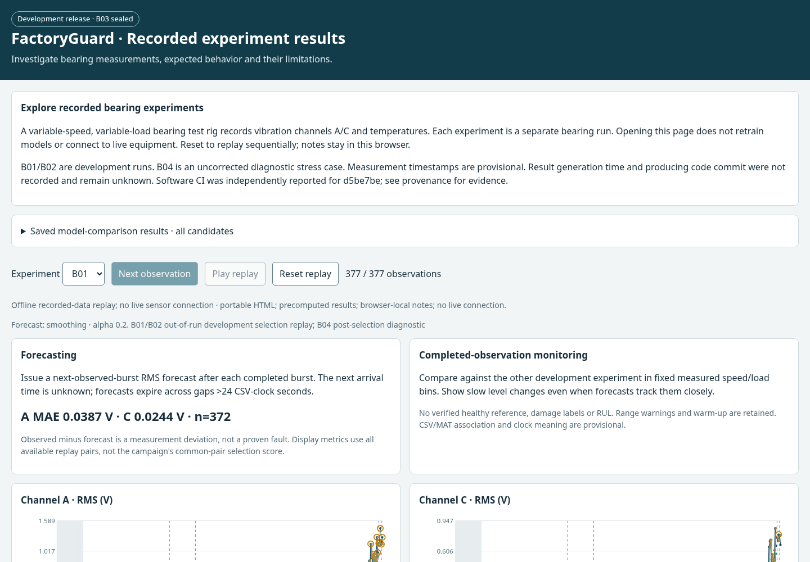

# FactoryGuard

[**Live dashboard — recorded experiment results**](https://bakk0u.github.io/factoryguard/)

Open in your browser; no installation, sign-in or dataset download required.

FactoryGuard helps an engineer investigate changes in bearing vibration and
temperature alongside measured speed, load, acquisition gaps and measurement
warnings. The website presents **real, precomputed laboratory results** from a
variable-speed, variable-load bearing rig. Opening it neither retrains a model nor
connects to live equipment. Experiments are separate bearing runs; A/C are
vibration channels on the same run.

Start with **Overview**, choose **Explore measurements**, select an experiment and
an observation or period, then inspect its operating context and reference support.
Use **Methods and evidence** to inspect every evaluated model and detailed provenance.

- Observed RMS, forecasts, persistence and settled errors, with gaps retained.
- Temperature above ambient, measured operating context and optional commanded values.
- Descriptive sudden/sustained changes and fixed development-reference support.
- Browser-local notes and downloadable selected-period investigation reports.

## Results and limits

Exponential smoothing was selected from a bounded comparison with persistence,
Ridge, randomized trees, gradient boosting and XGBoost. The saved procedure reports
**12.83% equal-run/channel MAE improvement** over persistence on reciprocal B01/B02
development evaluations. This is development-selection improvement, **not held-out
accuracy or fault-detection performance**. The overview shows the best-performing
evaluated variant within each family, not exhaustive optimization. Every evaluated
variant remains available, including worse results.

| Experiment | Role and interpretation |
| --- | --- |
| B01 / B02 | Development bearings; repeatedly inspected and used for selection. |
| B04 | Diagnostic only; unresolved measured speed/load scaling, retained uncorrected. |
| B03 | Still sealed; no inspection or evaluation authorized by this release task. |

Only two independent development bearings support selection. Timestamps and
CSV/MAT alignment are provisional; sensor-range warnings and ambiguous termination
information remain. Next-observed-burst forecasts have a variable horizon.
Development reference distributions are not healthy/safe ranges. These results
do not establish damage onset, fault probabilities, bearing health or RUL.

The reviewer handover recorded **116 passing local tests**, exact preservation of
**2,607 observations/predictions/errors** and **432 comparison rows**, plus browser
workflow checks. [Verification and publication evidence](docs/release_verification.md)
distinguishes local checks, independently reported CI and checks still pending.
[Model card](docs/model_card.md) · [Complete results](docs/results/release-v3/results.md)

## Notes, downloads and optional reproduction

The static website keeps notes in **your browser**, isolated by result snapshot
and experiment. They are not uploaded; export a report to share them. If storage
is unavailable, notes last only in the current tab. Replay progress is not saved.
The optional local Python application instead persists notes and replay state in
SQLite across resets/restarts. [Reviewer-site guide](docs/reviewer_site.md)

The `factoryguard-reviewer-site` artifact from
[CI](https://github.com/bakk0u/factoryguard/actions/workflows/ci.yml) can be extracted
and its `index.html` opened without installing Python or downloading raw data.
GitHub artifact downloads may require sign-in, unlike the public Pages site.

[Installation and full reproduction](docs/development_release.md) are optional.
[Architecture](docs/architecture.md) · [B03-readiness checklist](docs/b03_readiness.md)
· [Proposed v0.3.0 release notes](docs/releases/v0.3.0.md)

## Data attribution and licensing

Data: Osarenren Kennedy Aimiyekagbon, Paderborn University,
[Zenodo 10868257](https://doi.org/10.5281/zenodo.10868257),
[CC BY 4.0](https://creativecommons.org/licenses/by/4.0/).
Cite Javanmardi et al. (2024), *Remaining Useful Lifetime Estimation of Bearings
Operating under Time-Varying Conditions*, DOI 10.36001/phme.2024.v8i1.4101.
Waveforms were reduced to documented burst descriptors, context, warnings and
reference summaries; no raw waveforms or B03 data are published. No endorsement
is implied. [Attribution details](src/factoryguard/release/demo/ATTRIBUTION.md)
describe the smaller bundled B01 demo. The legacy `run_step1.py` demo is synthetic
and separate from the website results. No repository-wide software licence is
currently declared; the dataset licence does not assign a software licence.
