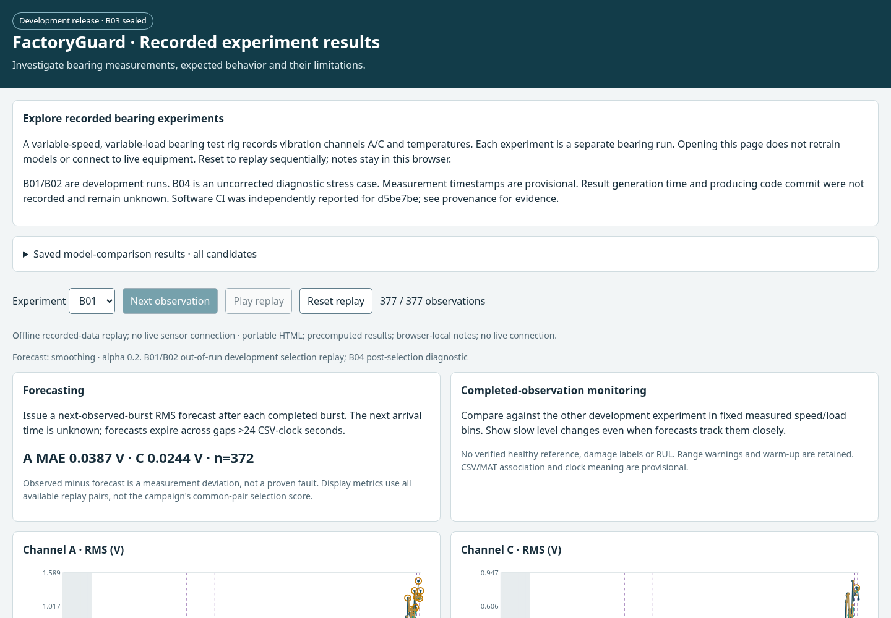
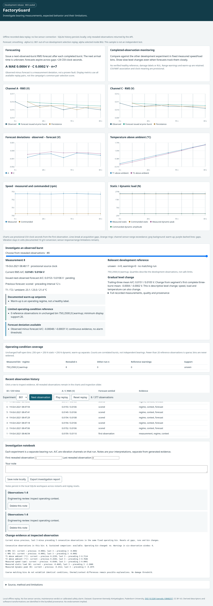

<picture>
  <source media="(max-width: 600px)" srcset="docs/images/readme/hero-mobile.svg">
  
</picture>

  <a href="https://bakk0u.github.io/factoryguard/"><b>Open the dashboard ↗</b></a> &nbsp; · &nbsp;
  <a href="#results--evidence">Results &amp; evidence</a> &nbsp; · &nbsp;
  <a href="docs/development_release.md">Reproduce locally</a> &nbsp; · &nbsp;
  <a href="docs/architecture.md">Architecture</a>

**Investigate changes in bearing vibration and temperature with the operating context beside them.** FactoryGuard brings together observed signals, forecasts, speed, load, acquisition gaps and measurement warnings in an interactive investigation dashboard.

> **Try it immediately:** the [public dashboard](https://bakk0u.github.io/factoryguard/) needs no installation, sign-in or dataset download. It presents **real, precomputed laboratory results**; it does not connect to live equipment or retrain a model when opened.

## Explore the dashboard

<a href="https://bakk0u.github.io/factoryguard/">
  <picture>
    <source media="(max-width: 600px)" srcset="docs/images/reviewer-mobile.png">
    
  </picture>
</a>

Actual dashboard screenshot · Click the image to explore

## From a change to an investigation

<picture>
  <source media="(max-width: 600px)" srcset="docs/images/readme/workflow-mobile.svg">
  
</picture>

Start in **Overview → Explore measurements**, select an experiment and an observation or period, then inspect its operating context and reference support. Open **Methods and evidence** to examine every evaluated model and its provenance.

| Investigate | What you can inspect |
| :--- | :--- |
| **Signal & forecast** | Observed RMS, model forecasts, persistence and settled errors, with acquisition gaps retained. |
| **Operating context** | Temperature above ambient, measured speed/load and optional commanded values. |
| **Changes & references** | Descriptive sudden/sustained changes and fixed development-reference support. |
| **Investigation record** | Browser-local notes and downloadable selected-period reports. |

<b>See the investigation view</b>

<picture>
  <source media="(max-width: 600px)" srcset="docs/images/investigation-mobile.png">
  
</picture>

Experiments are separate bearing runs. A/C are vibration channels on the same run.

## Results & evidence

| Development selection | Preserved replay evidence | Model comparison |
| :---: | :---: | :---: |
| **12.83%** MAE improvement | **2,607** observations/predictions/errors | **432** comparison rows |
| Equal-run/channel average vs persistence | Recorded in reviewer handover | Includes unsuccessful evaluated variants |

**Interpretation:** the 12.83% figure comes from reciprocal **B01/B02 development evaluations**, used for model selection. It is **not held-out accuracy or fault-detection performance**.

Exponential smoothing was selected from a bounded comparison with persistence, Ridge, randomized trees, gradient boosting and XGBoost. The dashboard overview shows the best evaluated variant within each family; it does not claim exhaustive optimization. Every evaluated variant remains available, including worse results.

[**Read the model card ↗**](docs/model_card.md) · [Complete results](docs/results/release-v3/results.md) · [Verification record](docs/release_verification.md)

| Bearing runs | Role | Boundary |
| :--- | :--- | :--- |
| **B01 / B02** | Development & selection | Repeatedly inspected and used for selection. |
| **B04** | Diagnostic only | Unresolved measured speed/load scaling, retained uncorrected. |
| **B03** | Sealed reserve | No inspection or evaluation authorized by this release task. |

> Forecast deviations and development references do **not** establish damage onset, fault probabilities, bearing health or remaining useful life. Development references are not healthy/safe ranges.

<b>Evaluation limitations & verification details</b>

Only two independent development bearings support model selection. Timestamps and CSV/MAT alignment are provisional; sensor-range warnings and ambiguous termination information remain. Next-observed-burst forecasts have a variable horizon.

The reviewer handover recorded **116 passing local tests**, preservation of the replay and comparison rows above, plus browser workflow checks. This is the recorded handover, not a claim that this documentation update reran those tests. The [verification record](docs/release_verification.md) distinguishes local checks, independently reported CI and checks still pending.

## Run it your way

| Path | Best for | Start here |
| :--- | :--- | :--- |
| **Public dashboard** | Exploring the results in your browser | [Open dashboard](https://bakk0u.github.io/factoryguard/) |
| **Downloadable reviewer site** | Opening a portable HTML export locally | [`factoryguard-reviewer-site` CI artifact](https://github.com/bakk0u/factoryguard/actions/workflows/ci.yml) |
| **Local Python application** | Reproduction and SQLite-backed investigation state | [Installation & full reproduction](docs/development_release.md) |

<b>Notes, persistence & download behavior</b>

The static website keeps notes **in your browser**, isolated by result snapshot and experiment. Notes are not uploaded; export a report to share them. When storage is unavailable, notes last only in the current tab. Replay progress is not saved.

The optional local Python application persists notes and replay state in SQLite across resets/restarts. See the [reviewer-site guide](docs/reviewer_site.md).

The CI artifact can be extracted and its `index.html` opened without installing Python or downloading raw data. GitHub artifact downloads may require sign-in; the public Pages site does not.

## Technical reading

| Document | Purpose |
| :--- | :--- |
| [Architecture](docs/architecture.md) | Data, evaluation, persistence and presentation components. |
| [Model card](docs/model_card.md) | Selection results, interpretation and limitations. |
| [Reviewer-site guide](docs/reviewer_site.md) | Investigation workflow, notes and exports. |
| [B03-readiness checklist](docs/b03_readiness.md) | Requirements for any future reserve evaluation. |
| [Proposed v0.3.0 release notes](docs/releases/v0.3.0.md) | Release scope and handover context. |

<b>Data attribution & licensing</b>

Data: **Osarenren Kennedy Aimiyekagbon, Paderborn University**, [Zenodo 10868257](https://doi.org/10.5281/zenodo.10868257), [CC BY 4.0](https://creativecommons.org/licenses/by/4.0/).

Cite Javanmardi et al. (2024), *Remaining Useful Lifetime Estimation of Bearings Operating under Time-Varying Conditions*, DOI **10.36001/phme.2024.v8i1.4101**.

Waveforms were reduced to documented burst descriptors, context, warnings and reference summaries; no raw waveforms or B03 data are published. No endorsement is implied. [Attribution details](src/factoryguard/release/demo/ATTRIBUTION.md) describe the smaller bundled B01 demo. The legacy `run_step1.py` demo is synthetic and separate from the website results.

No repository-wide software licence is currently declared; the dataset licence does not assign a software licence.

---

<a href="https://bakk0u.github.io/factoryguard/"><b>Explore FactoryGuard ↗</b></a> &nbsp; · &nbsp; Built by <a href="https://github.com/bakk0u">Anas Bakkoury</a>

