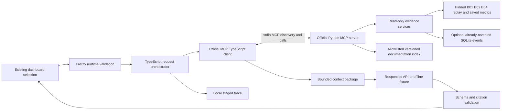

# Evidence-grounded investigation assistant (optional, local)

This extension adds an optional TypeScript application service; the existing Python
CLI, SQLite replay app, saved forecasting results and static public site stay usable
independently. No forecasting model is retrained. The static site has no assistant
backend, credentials or misleading live preview: the new entry point is injected
only when the local assistant service serves the existing reviewer dashboard.

## Setup and one-command startup

Use the existing CPython 3.12 environment and Node.js >=22:

```bash
python -m pip install -r requirements-assistant-lock.txt
python -m pip install --no-deps -e .
npm ci --prefix assistant
python scripts/start_assistant.py
```

Open <http://127.0.0.1:8785/> on the same machine. Choose Explore, a channel and
period, then Ask about this period. Default **offline mode** still retrieves real
saved measurements through actual MCP, but generation uses a visibly labelled
deterministic fixture. It demonstrates plumbing, not language-model capability.
No Python server, SDK or key is required by visitors to the existing public site.

For opt-in live generation, supply `OPENAI_API_KEY` privately in the server
environment and run `python scripts/start_assistant.py --live`. Model defaults to
`gpt-5.4-mini`; override `FACTORYGUARD_LLM_MODEL` explicitly. The launcher does not
load arbitrary dotenv files. No key reaches JavaScript in the browser, MCP
subprocesses or traces. `assistant/.env.example` lists configuration names only.

A separate bounded live check is `FACTORYGUARD_ALLOW_LIVE=1 npm run live-smoke
--prefix assistant` with the key already set (PowerShell: set environment variables
using `$env:NAME=...`). No live model check is claimed without executing it. This
task leaves merging, external deployment and public assistant exposure out of scope.

## Retrieve → assemble → generate



Before the **first** generation call, orchestration retrieves replay state, Python
period summary, quality report, an observation page and documentation through the
MCP client. It does not give a language model an empty context and hope for a tool
call. Subsequent model turns may request more retrieval, with the original user
selection enforced again on every call. OpenAI requests are deliberately stateless
per turn: each receives the question plus the newly assembled context package;
Responses history/`previous_response_id` is not partially replayed.

The versioned package contains numerical records with units, provisional timestamps,
channel/experiment/position, stable source IDs and snapshot hashes; approved passages
with path/section/document hashes; missing-evidence entries; warnings and limits.
It deduplicates IDs and passage content, prioritizes summaries/quality and bounds
serialized context to 28,000 characters. Omitted records and missing passages are
explicit. Numerical calculations run only in Python, using saved values/errors.
The LLM receives no raw waveforms or private investigation notes.

Structured answers separate observations, retrieved explanations, interpretations,
missing evidence, limitations and suggested steps. Claims carry evidence IDs;
the application rejects IDs absent from the assembled package. Citation membership
is mechanically checked; semantic entailment and general factual correctness of
live model prose are **not** established by this check or the offline fixture.

## Contracts and read-only tools

`Selection`: experiment B01/B02/B04, channel A/C, inclusive **1-based observation
positions** start/stop, as_of, replay/retrospective mode and exact snapshot SHA256.
These are not elapsed operating-time windows. Unknown fields, sealed/invalid runs,
invalid channels/periods and mismatched snapshots are rejected. The server exposes
seven SDK-discovered tools:

| Tool | Bounded result |
| --- | --- |
| list_experiments | Allowed runs/roles only, no B03 |
| get_replay_state | Selected visible position and provisional timestamp |
| get_measurements | At most 12 bursts/page, units, saved issued/settled forecasts/errors, warnings |
| get_investigation_summary | Whole selected visible period, deterministic RMS/error summaries |
| get_data_quality_report | Gap/warning positions (first 30 with total counts), warm-up/reference support |
| get_model_comparison | At most 12 saved rows for selected run/channel/group; retrospective only |
| search_documentation | At most six approved passages, versioned citations |

The exact runtime contracts are in `assistant/src/contracts.ts`, Python Selection
and MCP-discovered schemas. Observation units/finite-or-null values, channel/position
scope, final answer structure and citation membership are checked at runtime.
There is no SQL tool, arbitrary path parameter, shell tool, note tool or machine
control. Model tool schemas are derived from MCP discovery rather than invented.

Default replay uses the explicitly supplied as_of position on a public precomputed
snapshot. It is a causal evidence boundary, not access control over already-public
files. Set `FACTORYGUARD_EVIDENCE_WORKSPACE` for authoritative local cursor checks:
Python opens SQLite read-only, reads only events at/before the revealed cursor,
and checks them against the pinned events. TypeScript never writes SQLite. No
ordinary loader/guard is relaxed for B03.

Replay never exposes future observations/outcomes, and full-run comparison scores
are withheld. Only pre-replay methodological documentation is searched in this
mode; retrospective analysis is explicitly labelled. Fixed other-development-run
references are pre-existing baselines, not the selected run's future observations.
Settled errors are grouped by target arrival within the selected period; the
issuing burst can precede the period. All suspect measurements remain recorded.

## Reliable Python-owned workflows and retrieval

```bash
python -m factoryguard.assistant.workflows validate
python -m factoryguard.assistant.workflows refresh
python -m factoryguard.assistant.workflows index
python -m factoryguard.assistant.workflows bundle --selection '{"experiment":"B01","channel":"A","start":1,"stop":8,"as_of":8,"mode":"replay","snapshot":"9a3da297dd848bf079a0c8ff1fa9fd3be1dea42894e867fb51c2fdf35efa624a"}'
python -m factoryguard.assistant.evaluate
```

Evaluation writes the per-case JSON report and exits 1 when any case fails, so
CI can detect retrieval regressions. Keep the frozen case manifest unchanged.
See the [verification follow-up](results/assistant-v1/report.md#follow-up-verification--2026-11-07)
for the Windows fixture cleanup fix and current dependency/review limitations.

All outputs default to ignored `reports/local/assistant/`. Validation checks pinned
source hashes/allowed experiments; refresh reuses content-addressed derived
summaries when unchanged; bundles are atomic selected-period evidence outputs.
Index refresh handles changed/deleted documents in one SQLite transaction with
run records; injected interruptions roll back and reruns recover. Repeated unchanged
inputs do not duplicate records or embeddings. Temporary files are fsynced and
atomically renamed. Source/raw output protection is reused. Dagster was deliberately
not added: a small explicit runner has one orchestration owner, fewer dependencies
and no scheduler; the required operations are independently callable.

Documentation is an explicit allowlist (`assistant/retrieval.py`): current feature
definitions, frozen release protocol, investigation workflow, and retrospective-only
current model card/development assessment. Historical model-card sections, raw
data, notes, secrets and all other files are excluded. Initial retrieval is a
reproducible lexical term-frequency/IDF baseline. Stable passage IDs include
source path, section, document hash and chunk position; text is deduplicated.
Stale/deleted indexed passages fail closed until refreshed.

Optional local embeddings: FastEmbed 0.9.1, `BAAI/bge-small-en-v1.5`, MIT,
384-dimensional quantized ONNX from `Qdrant/bge-small-en-v1.5-onnx-Q`. An explicit
`index --embeddings` downloads weights into ignored `.tools/embeddings`; successful
builds record exact ONNX/tokenizer/config hashes and refuse a changed cache during
query. Hybrid ranking is reciprocal-rank fusion (constant 60) of lexical and local
embedding ranks. Query uses cached weights only. No embedding/vector cloud service.
The model download was blocked here by `huggingface.co` proxy 403; real hybrid
quality/latency cannot be reported. Missing vectors never silently become synthetic
embeddings or an unlabelled lexical fallback. Do not recommend hybrid over the
baseline until a real comparison succeeds.

## SDKs, limits, lifecycle and trace interpretation

Verified official SDK documentation/source: OpenAI TypeScript README Responses API
and declarations from installed `openai@7.53.0`; official MCP TypeScript client/
stdio APIs at `@modelcontextprotocol/sdk@1.32.2`; Python SDK tag v1.30.0 commit
`8c2fa6eabacde869d75568e33b9d466b58c2f512`, FastMCP typed tools and stdio. Python
1.30.0 is an explicitly pinned supported maintenance line (v2.3.0 was current);
do not upgrade major versions without integration tests. Fastify 5.12.8 and Zod
4.6.7 supply the application/runtime boundary. npm lock and optional Python lock
pin dependencies without changing the existing core requirement pins.

Each investigation owns a fresh local MCP subprocess and closes it on success,
error or cancellation. A subsequent request starts cleanly after failure; invalid
requests are not retried. MCP requests time out after 15s. The model has at most
three turns, nine total evidence calls, 2,200 output tokens/turn, SDK timeout 30s
and at most one SDK retry for transient provider failures. Whole-request timeout
is 60s, three concurrent jobs, 50 retained job slots. The API is loopback-only with
same-origin checks; it is not authenticated multiuser/enterprise infrastructure.

POST `/api/investigations` returns 202/request_id; GET that URL returns state/result,
GET `/events` streams staged progress over SSE, POST `/cancel` aborts. The browser
shows no partial free-form model claims while a structured answer is incomplete.
Controls use the existing selected experiment/channel/period/replay context.

Local atomic trace JSON records request/session IDs, prompt version, selection,
retrieval configuration, tool results/failures, assembled packages, model identity,
usage when available, latency and validated final answer. Failure stages distinguish
retrieval, assembly and generation (or API/trace validation). The trace also records
checkout HEAD and a dirty-worktree flag, rather than misrepresenting uncommitted
code as a clean source revision. Provider refusals/
malformed JSON fail explicitly; unsupported citations are rejected. Model response
token usage is null when unavailable, never estimated from fixture text. No monetary
cost is recorded because no documented pricing configuration is supplied. User
questions/traces can be sensitive: retain locally, never add them to Git. Credential
patterns and the configured key are redacted; no environment dump is stored.

## Verification, interpretation and troubleshooting

[Evaluation report](results/assistant-v1/report.md) distinguishes executed offline
checks from unexecuted live/hybrid/human review. Tests:

```bash
python -m unittest discover -s tests -v
npm run build --prefix assistant
npm test --prefix assistant
CHROMIUM_PATH=/usr/bin/chromium node assistant/test/browser.cjs
```

For existing-only installs, optional assistant tests explicitly skip when MCP is
absent. Install the optional lock to execute them. Browser checks require Playwright
and Chromium in addition to application dependencies. On Windows omit the Linux
browser override and use the appropriate executable path. No browser test data is
silently substituted for the real MCP-backed evidence.

- Missing key: default offline mode works; live requires a server key and explicit
  flag. Do not put keys into browser storage, a URL or the static site.
- Missing/stale documentation index: run the Python index workflow; numerical-only
  responses carry explicit missing-document limitations.
- Snapshot mismatch: restore matching pinned artifacts; never waive the hash check.
- SQLite ahead-of-cursor request: reveal observations through the existing app or
  choose a visible period. Do not query future rows to fill missing evidence.
- Retrieval versus model failure: inspect the trace's staged events, not only an
  empty answer. Cancel/retry starts a new bounded request; avoid retry loops.
- Embedding 403: obtain the approved model through permitted access, verify/store
  its hashes and run the frozen lexical/hybrid comparison. Do not bypass policy.

CV suggestions supported by implementation (avoid claims of fault-detection or
unexecuted LLM accuracy):

- Built an optional TypeScript/Python investigation assistant with official MCP
  tool discovery, deterministic numerical evidence, replay-safe retrieval and
  schema/citation validation.
- Implemented atomic documentation-index workflows, bounded orchestration and
  staged failure traces, with offline end-to-end tests and a frozen 40-case
  evidence/retrieval evaluation set.
